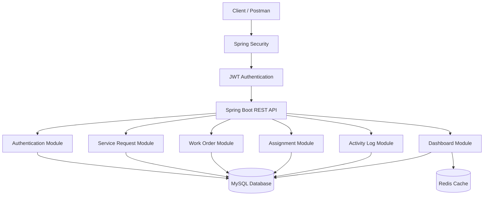
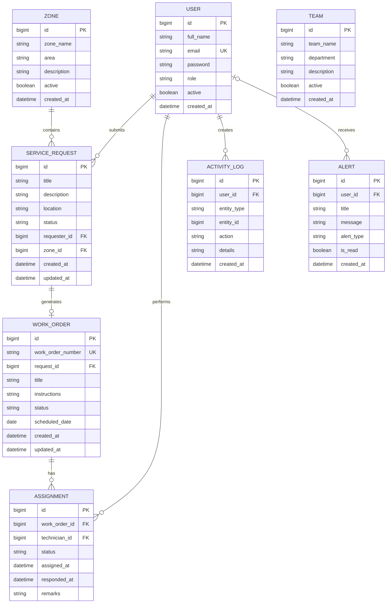
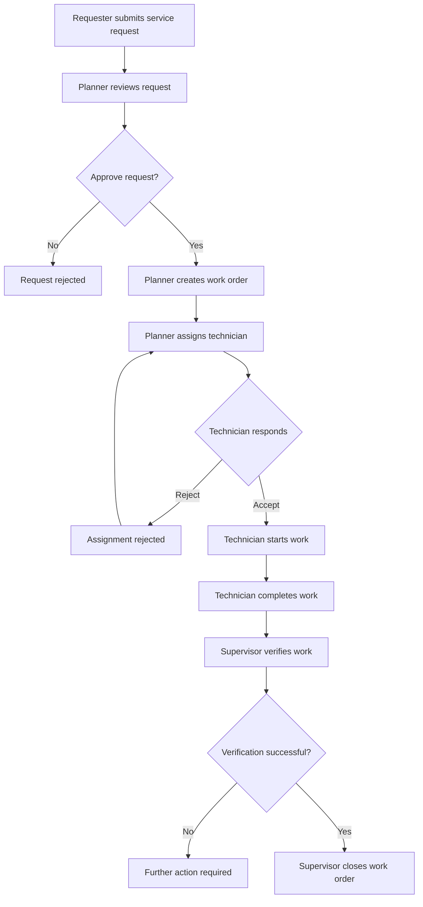

# FieldFlow – Field Operations Management System

A backend system built with Spring Boot to manage field service requests, work orders, technician assignments, and operational activities.

## Project Overview

FieldFlow helps organizations manage field operations through a structured workflow. Requesters can submit service requests, planners can review requests and create work orders, technicians can accept and complete assigned work, and supervisors can verify and close completed work orders.

## Key Features

- JWT-based authentication and role-based authorization
- Service request creation and management
- Work order creation and lifecycle management
- Technician assignment and work status updates
- Supervisor verification and closure
- Activity logging and audit history
- Dashboard summary with Redis caching
- MySQL database integration
- Docker-based Redis setup

## Technology Stack

| Component | Technology |
|---|---|
| Backend | Java 21, Spring Boot |
| Database | MySQL 8 |
| Caching | Redis |
| Security | Spring Security, JWT |
| ORM | Spring Data JPA, Hibernate |
| Build Tool | Maven |
| API Testing | Postman |
| Containerization | Docker |

## User Roles

- **ADMIN:** Administrative access
- **PLANNER:** Reviews requests and creates work orders and assignments
- **SUPERVISOR:** Verifies and closes completed work orders
- **TECHNICIAN:** Accepts assignments and updates work progress
- **REQUESTER:** Submits service requests

## Main Modules

- Authentication
- User Management
- Team Management
- Zone Management
- Service Requests
- Work Orders
- Technician Assignments
- Activity Logs
- Alerts
- Dashboard

## Project Status

Core backend workflows, authentication, role-based authorization, Redis dashboard caching, and Postman API testing have been implemented.

More detailed architecture diagrams, API documentation, setup instructions, and demonstration details will be added below.

## System Architecture

FieldFlow follows a modular monolithic architecture. The application is organized into separate logical modules within a single Spring Boot application.



### Architecture Description

- **Client Layer:** Sends HTTP requests through REST APIs.
- **Security Layer:** Validates JWT tokens and enforces role-based access.
- **Application Layer:** Handles business logic through modular services.
- **Persistence Layer:** Uses Spring Data JPA and MySQL for relational data storage.
- **Caching Layer:** Uses Redis to cache dashboard summaries with a 60-second expiration time.

The modular monolithic design keeps the application maintainable while allowing individual modules to be extracted into separate services in the future if required.

## Database Design – ER Diagram

The application uses MySQL to store users, teams, zones, service requests, work orders, assignments, activity logs, and alerts.



### Entity Relationships

- A user can submit multiple service requests.
- A zone can contain multiple service requests.
- An approved service request can generate a work order.
- A work order can have multiple assignment records over its lifecycle.
- A technician can receive multiple assignments.
- Activity logs record actions performed by users.
- Alerts can be associated with individual users.

## Field Operations Workflow

FieldFlow follows a controlled workflow to ensure that service requests are reviewed, assigned, completed, and verified before closure.



### Workflow Rules

1. Only approved service requests can generate work orders.
2. A technician must accept an assignment before starting work.
3. Only the assigned technician can update the assignment status.
4. Work orders can only be verified after completion.
5. Only supervisors or administrators can verify and close work orders.
6. Important workflow transitions are recorded in the activity log.
7. Assignment records are retained to preserve assignment history.

### Work Order Lifecycle

`CREATED → ASSIGNED → ACCEPTED → IN_PROGRESS → COMPLETED → VERIFIED → CLOSED`

Additional statuses include `CANCELLED` and `REJECTED` at the assignment level.

## API Documentation

Base URL:

`http://localhost:8080`

All protected endpoints require a JWT access token.

Add the following header:

`Authorization: Bearer <your-token>`

### 1. Authentication APIs

| Method | Endpoint | Description | Access |
|---|---|---|---|
| POST | `/api/auth/login` | Authenticate and obtain JWT | Public |

### 2. Service Request APIs

| Method | Endpoint | Description | Access |
|---|---|---|---|
| POST | `/api/requests?requesterId={id}` | Create service request | Requester/Admin |
| GET | `/api/requests` | Get all requests | Authenticated |
| GET | `/api/requests/{id}` | Get request by ID | Authenticated |
| PATCH | `/api/requests/{id}/approve` | Approve request | Planner/Admin |
| PATCH | `/api/requests/{id}/reject` | Reject request | Planner/Admin |

### 3. Work Order APIs

| Method | Endpoint | Description | Access |
|---|---|---|---|
| POST | `/api/work-orders?plannerId={id}` | Create work order | Planner/Admin |
| PATCH | `/api/work-orders/{id}/verify?supervisorId={id}` | Verify completed work | Supervisor/Admin |
| PATCH | `/api/work-orders/{id}/close?supervisorId={id}` | Close verified work order | Supervisor/Admin |

### 4. Assignment APIs

| Method | Endpoint | Description | Access |
|---|---|---|---|
| POST | `/api/assignments?plannerId={id}` | Assign technician | Planner/Admin |
| PATCH | `/api/assignments/{id}/accept?technicianId={id}` | Accept assignment | Technician/Admin |
| PATCH | `/api/assignments/{id}/reject?technicianId={id}` | Reject assignment | Technician/Admin |
| PATCH | `/api/assignments/{id}/start?technicianId={id}` | Start assigned work | Technician/Admin |
| PATCH | `/api/assignments/{id}/complete?technicianId={id}` | Complete assigned work | Technician/Admin |

### 5. Dashboard API

| Method | Endpoint | Description | Access |
|---|---|---|---|
| GET | `/api/dashboard/summary` | Get operational summary | Authenticated |

### API Testing

A Postman collection is available in the `postman/` directory:

`postman/FieldFlow.postman_collection.json`

The collection includes authentication, service request, work order, assignment, and dashboard requests.

## Installation and Setup

### Prerequisites

Make sure the following tools are installed:

- Java 21
- Maven 3.9+
- MySQL 8+
- Docker Desktop
- Git
- Postman (optional, for API testing)

### 1. Clone the Repository

```bash
git clone <YOUR_GITHUB_REPOSITORY_URL>
cd feildflow
```

### 2. Create the MySQL Database

Open MySQL Workbench and execute:

```sql
CREATE DATABASE fieldflow_db;
```

### 3. Configure Environment Variables

The application uses environment variables for database credentials and the JWT signing key.

On Windows Command Prompt:

```cmd
set DB_PASSWORD=your_mysql_password
set JWT_SECRET=your_secure_jwt_secret_key
```

Use your own MySQL password and a secure JWT secret of at least 32 characters.

Keep these variables set in the same terminal session used to run the application.

### 4. Start Redis Using Docker

Make sure Docker Desktop is running.

```bash
docker run -d --name fieldflow-redis -p 6379:6379 redis:7-alpine
```

If the container already exists, start it using:

```bash
docker start fieldflow-redis
```

### 5. Build and Run the Application

From the project root directory:

```bash
mvn clean package -DskipTests
mvn spring-boot:run
```

The application runs at:

`http://localhost:8080`

### 6. Test the APIs

Import the Postman collection:

`postman/FieldFlow.postman_collection.json`

Authenticate using the login API and use the returned JWT token for protected endpoints.

## Configuration Notes

- MySQL stores application data.
- Redis is used for dashboard summary caching.
- Dashboard cache entries expire after 60 seconds.
- Database schema updates are managed through Hibernate during application startup.

**Note:** The application expects the MySQL database and Redis service to be running before startup.


## Redis Caching

FieldFlow uses Redis to improve dashboard response performance.

### Implementation

- Dashboard summary data is cached using Spring Cache and Redis.
- The cache key is `dashboardSummary::summary`.
- Cache entries have a time-to-live (TTL) of 60 seconds.
- Dashboard data is retrieved from MySQL when the cache is empty or expired.
- Cache entries are evicted when relevant service requests, work orders, or assignments are modified.

### Benefits

- Reduces repeated database queries for dashboard summaries.
- Improves response time for frequently accessed dashboard data.
- Keeps cached data reasonably fresh through expiration and invalidation.

## Security

FieldFlow implements authentication and authorization using Spring Security and JSON Web Tokens (JWT).

### Security Features

- JWT-based authentication.
- BCrypt password hashing.
- Role-based access control.
- Stateless session management.
- Protected REST API endpoints.
- Custom handling for unauthorized and forbidden requests.

### Supported Roles

`ADMIN`, `PLANNER`, `SUPERVISOR`, `TECHNICIAN`, `REQUESTER`

### HTTP Security Responses

| Status Code | Meaning |
|---|---|
| 200 | Request successful |
| 400 | Invalid request or business rule violation |
| 401 | Authentication required or invalid token |
| 403 | Insufficient permissions |
| 404 | Resource not found |
| 500 | Internal server error |