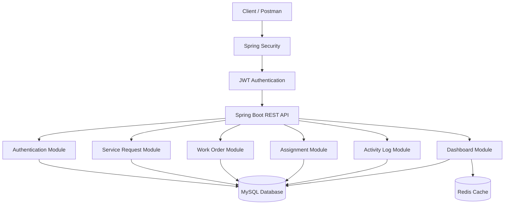
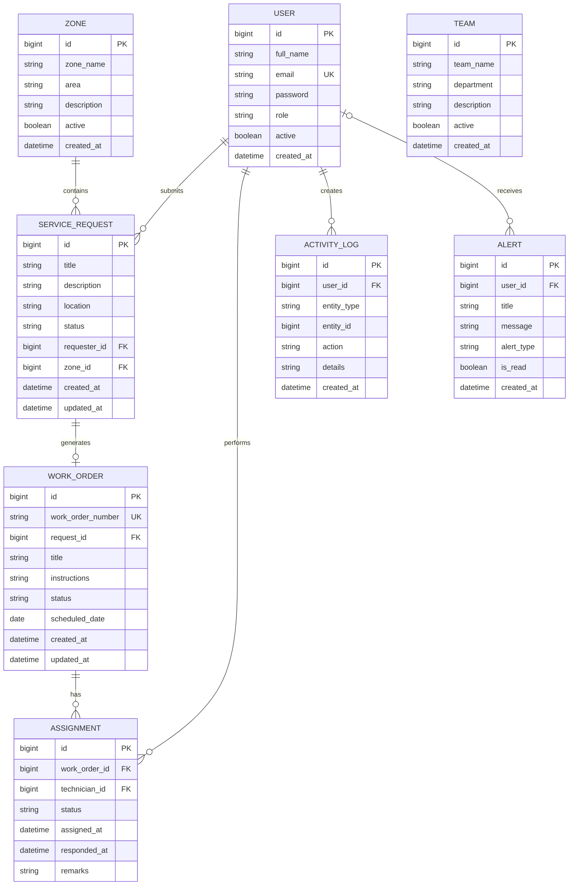
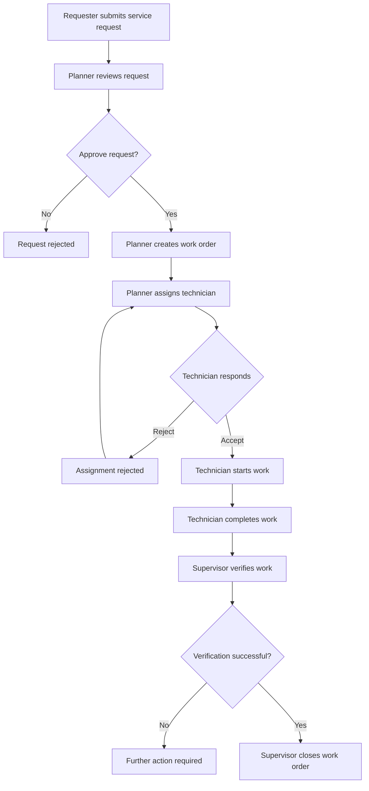

# FieldFlow – Field Operations Management System

A backend system built with Spring Boot to manage field service requests, work orders, technician assignments, and operational activities.

## Project Overview

FieldFlow helps organizations manage field operations through a structured workflow. Requesters can submit service requests, planners can review requests and create work orders, technicians can accept and complete assigned work, and supervisors can verify and close completed work orders.

## Research and Problem Understanding

### 1. Service Request Management

Service request management is the process of receiving, recording, reviewing, prioritizing, and tracking requests for maintenance or operational support.

In infrastructure operations, requests may come from citizens, employees, customers, or field staff. Examples include damaged roads, water leakage, broken streetlights, and sanitation issues.

### 2. Field Maintenance Operations

Field maintenance operations involve planning and executing physical maintenance activities at specific locations.

The process generally includes:
- Reviewing and approving maintenance requests.
- Creating work orders with instructions.
- Identifying suitable technicians and available resources.
- Assigning work based on operational requirements and location.
- Tracking execution and completion.
- Verifying the work before closing the work order.

### 3. Operational Responsibilities

| Actor | Responsibility |
|---|---|
| Requester | Reports maintenance issues and tracks requests |
| Planner | Reviews requests, creates work orders, and assigns technicians |
| Technician | Accepts assignments and performs field work |
| Supervisor | Monitors operations, verifies completed work, and closes work orders |
| Administrator | Manages users and administrative access |

### 4. Resource Allocation Approach

In a real field service environment, resource allocation may consider technician skills, availability, workload, team membership, location, urgency, and required equipment.

In FieldFlow, the planner manually selects a technician for an approved work order. Automated scheduling and optimization based on skills, distance, and availability are future enhancements.

## Architecture Decisions and Service Boundaries

### 1. Current Architecture

FieldFlow is implemented as a modular monolithic Spring Boot application.

The following logical service boundaries are used:

- **Authentication and User Management:** Handles login, user information, and access control.
- **Service Request Management:** Handles request creation, review, approval, and rejection.
- **Work Order Management:** Handles work order creation, verification, and closure.
- **Assignment Management:** Handles technician assignment and execution status.
- **Activity Logging:** Records important operational actions.
- **Alert Management:** Provides the data model for operational alerts.
- **Dashboard:** Provides operational summary data using Redis caching.

### 2. Future Microservice Architecture

These modules could be extracted into independent services as the system grows.

For example, Service Request, Work Order, Assignment, Notification, and Reporting services could communicate through REST APIs or asynchronous events.

The current implementation uses a modular monolith to keep deployment and development manageable for the scope of this project.

## Real-Time Monitoring Approach

The current backend exposes a dashboard summary API that can be called repeatedly by a frontend to refresh operational information.

Redis caches dashboard summary data with a 60-second TTL, and relevant data modifications trigger cache eviction.

WebSocket communication and event-driven real-time notifications are not implemented. They could be introduced in a future version for immediate status updates and operational alerts.

## Alerts, Notifications and PDF Reports

### Alerts and Notifications

An Alert entity is included in the database design to represent operational alerts.

Automated notification delivery for delays, priority changes, escalations, email, SMS, and push notifications is not implemented in the current version.

These features could be added through a dedicated notification module or service.

### PDF Generation

Automatic PDF generation for work orders, inspection reports, and completion reports is not implemented.

This is considered a future enhancement that could provide downloadable operational documents and maintenance records.

## Implementation Scope and Trade-offs

| Area | Implementation |
|---|---|
| Authentication | JWT authentication and role-based authorization |
| Service requests | Implemented |
| Work orders | Implemented |
| Technician assignments | Implemented |
| Work completion and verification | Implemented |
| Activity logging | Implemented |
| Dashboard caching | Implemented using Redis |
| Docker deployment | Implemented using Docker Compose |
| Alerts | Entity implemented; automated delivery skipped |
| Microservices | Logical boundaries designed; modular monolith implemented |
| Real-time updates | API-based retrieval; WebSockets skipped |
| PDF generation | Skipped |

The project prioritizes a complete operational workflow, clear business rules, role-based access, auditability, and a reproducible Docker-based environment over implementing every possible feature.

## Key Features

- JWT-based authentication and role-based authorization
- Service request creation and management
- Work order creation and lifecycle management
- Technician assignment and work status updates
- Supervisor verification and closure
- Activity logging and audit history
- Dashboard summary with Redis caching
- MySQL database integration
- Docker-based Redis setup

## Technology Stack

| Component | Technology |
|---|---|
| Backend | Java 21, Spring Boot |
| Database | MySQL 8 |
| Caching | Redis |
| Security | Spring Security, JWT |
| ORM | Spring Data JPA, Hibernate |
| Build Tool | Maven |
| API Testing | Postman |
| Containerization | Docker |

## User Roles

- **ADMIN:** Administrative access
- **PLANNER:** Reviews requests and creates work orders and assignments
- **SUPERVISOR:** Verifies and closes completed work orders
- **TECHNICIAN:** Accepts assignments and updates work progress
- **REQUESTER:** Submits service requests

## Main Modules

- Authentication
- User Management
- Team Management
- Zone Management
- Service Requests
- Work Orders
- Technician Assignments
- Activity Logs
- Alerts
- Dashboard

## Project Status

Core backend workflows, JWT authentication, role-based authorization, Redis dashboard caching, Docker Compose deployment, and Postman API testing have been implemented.

More detailed architecture diagrams, API documentation, setup instructions, and demonstration details will be added below.

## System Architecture

FieldFlow follows a modular monolithic architecture. The application is organized into separate logical modules within a single Spring Boot application.



### Architecture Description

- **Client Layer:** Sends HTTP requests through REST APIs.
- **Security Layer:** Validates JWT tokens and enforces role-based access.
- **Application Layer:** Handles business logic through modular services.
- **Persistence Layer:** Uses Spring Data JPA and MySQL for relational data storage.
- **Caching Layer:** Uses Redis to cache dashboard summaries with a 60-second expiration time.

The modular monolithic design keeps the application maintainable while allowing individual modules to be extracted into separate services in the future if required.

## Database Design – ER Diagram

The application uses MySQL to store users, teams, zones, service requests, work orders, assignments, activity logs, and alerts.



### Entity Relationships

- A user can submit multiple service requests.
- A zone can contain multiple service requests.
- An approved service request can generate a work order.
- A work order can have multiple assignment records over its lifecycle.
- A technician can receive multiple assignments.
- Activity logs record actions performed by users.
- Alerts can be associated with individual users.

## Field Operations Workflow

FieldFlow follows a controlled workflow to ensure that service requests are reviewed, assigned, completed, and verified before closure.



### Workflow Rules

1. Only approved service requests can generate work orders.
2. A technician must accept an assignment before starting work.
3. Only the assigned technician can update the assignment status.
4. Work orders can only be verified after completion.
5. Only supervisors or administrators can verify and close work orders.
6. Important workflow transitions are recorded in the activity log.
7. Assignment records are retained to preserve assignment history.

### Work Order Lifecycle

`CREATED → ASSIGNED → ACCEPTED → IN_PROGRESS → COMPLETED → VERIFIED → CLOSED`

Additional statuses include `CANCELLED` and `REJECTED` at the assignment level.

## API Documentation

Base URL:

`http://localhost:8080`

All protected endpoints require a JWT access token.

Add the following header:

`Authorization: Bearer <your-token>`

### 1. Authentication APIs

| Method | Endpoint | Description | Access |
|---|---|---|---|
| POST | `/api/auth/login` | Authenticate and obtain JWT | Public |

### 2. Service Request APIs

| Method | Endpoint | Description | Access |
|---|---|---|---|
| POST | `/api/requests?requesterId={id}` | Create service request | Requester/Admin |
| GET | `/api/requests` | Get all requests | Authenticated |
| GET | `/api/requests/{id}` | Get request by ID | Authenticated |
| PATCH | `/api/requests/{id}/approve` | Approve request | Planner/Admin |
| PATCH | `/api/requests/{id}/reject` | Reject request | Planner/Admin |

### 3. Work Order APIs

| Method | Endpoint | Description | Access |
|---|---|---|---|
| POST | `/api/work-orders?plannerId={id}` | Create work order | Planner/Admin |
| PATCH | `/api/work-orders/{id}/verify?supervisorId={id}` | Verify completed work | Supervisor/Admin |
| PATCH | `/api/work-orders/{id}/close?supervisorId={id}` | Close verified work order | Supervisor/Admin |

### 4. Assignment APIs

| Method | Endpoint | Description | Access |
|---|---|---|---|
| POST | `/api/assignments?plannerId={id}` | Assign technician | Planner/Admin |
| PATCH | `/api/assignments/{id}/accept?technicianId={id}` | Accept assignment | Technician/Admin |
| PATCH | `/api/assignments/{id}/reject?technicianId={id}` | Reject assignment | Technician/Admin |
| PATCH | `/api/assignments/{id}/start?technicianId={id}` | Start assigned work | Technician/Admin |
| PATCH | `/api/assignments/{id}/complete?technicianId={id}` | Complete assigned work | Technician/Admin |

### 5. Dashboard API

| Method | Endpoint | Description | Access |
|---|---|---|---|
| GET | `/api/dashboard/summary` | Get operational summary | Authenticated |

### API Testing

A Postman collection is available in the `postman/` directory:

`postman/FieldFlow.postman_collection.json`

The collection includes authentication, service request, work order, assignment, and dashboard requests.

## Installation and Setup

### Prerequisites

- Docker Desktop
- Git
- Postman (optional, for API testing)

### 1. Clone the Repository

```bash
git clone https://github.com/dafalsanika30/FieldFlow.git
cd FieldFlow
```

### 2. Start All Services Using Docker Compose

Make sure Docker Desktop is running.

```bash
docker compose up --build -d
```

This starts:
- Spring Boot backend
- MySQL 8 database
- Redis cache

### 3. Verify Container Status

```bash
docker compose ps
```

### 4. View Application Logs

```bash
docker compose logs -f app
```

### 5. Service Access

| Service | Address |
|---|---|
| Spring Boot API | http://localhost:8080 |
| MySQL | localhost:3307 |
| Redis | localhost:6380 |

### 6. Test the APIs

Import the Postman collection:

`postman/FieldFlow.postman_collection.json`

Login using one of the demo accounts and use the returned JWT token for protected endpoints.

### 7. Stop the Application

```bash
docker compose down
```

To stop services and remove the MySQL database volume:

```bash
docker compose down -v
```

**Warning:** The second command permanently deletes the database data stored in the Docker volume.

### 8. Local Development (Alternative)

For development without Docker Compose, install Java 21, Maven 3.9+, MySQL 8+, and Redis 7.

Create the database:

```sql
CREATE DATABASE fieldflow_db;
```

Configure environment variables in Windows Command Prompt:

```cmd
set DB_PASSWORD=your_mysql_password
set JWT_SECRET=your_secure_jwt_secret_key_of_at_least_32_characters
```

Start Redis:

```bash
docker run -d --name fieldflow-redis -p 6379:6379 redis:7-alpine
```

Build and run:

```bash
mvn clean package -DskipTests
mvn spring-boot:run
```

The API runs at http://localhost:8080.

## Configuration Notes

- MySQL stores application data.
- Redis is used for dashboard summary caching.
- Dashboard cache entries expire after 60 seconds.
- Database schema updates are managed through Hibernate during application startup.

**Note:** The application expects the MySQL database and Redis service to be running before startup.


## Redis Caching

FieldFlow uses Redis to improve dashboard response performance.

### Implementation

- Dashboard summary data is cached using Spring Cache and Redis.
- The cache key is `dashboardSummary::summary`.
- Cache entries have a time-to-live (TTL) of 60 seconds.
- Dashboard data is retrieved from MySQL when the cache is empty or expired.
- Cache entries are evicted when relevant service requests, work orders, or assignments are modified.

### Benefits

- Reduces repeated database queries for dashboard summaries.
- Improves response time for frequently accessed dashboard data.
- Keeps cached data reasonably fresh through expiration and invalidation.

## Security

FieldFlow implements authentication and authorization using Spring Security and JSON Web Tokens (JWT).

### Security Features

- JWT-based authentication.
- BCrypt password hashing.
- Role-based access control.
- Stateless session management.
- Protected REST API endpoints.
- Custom handling for unauthorized and forbidden requests.

### Supported Roles

`ADMIN`, `PLANNER`, `SUPERVISOR`, `TECHNICIAN`, `REQUESTER`

### HTTP Security Responses

| Status Code | Meaning |
|---|---|
| 200 | Request successful |
| 400 | Invalid request or business rule violation |
| 401 | Authentication required or invalid token |
| 403 | Insufficient permissions |
| 404 | Resource not found |
| 500 | Internal server error |

## Demo Accounts

The application automatically creates the following demo accounts on startup if they do not already exist.

| Role | Email | Password |
|---|---|---|
| Requester | requester@test.com | test123 |
| Planner | planner@test.com | test123 |
| Technician | technician@test.com | test123 |
| Supervisor | supervisor@test.com | test123 |

**Note:** These credentials are intended for local demonstration and evaluation only. Passwords are stored using BCrypt hashing. Do not use these credentials in production.